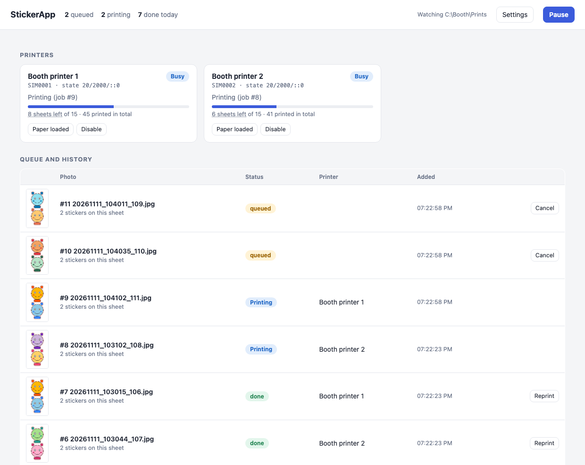
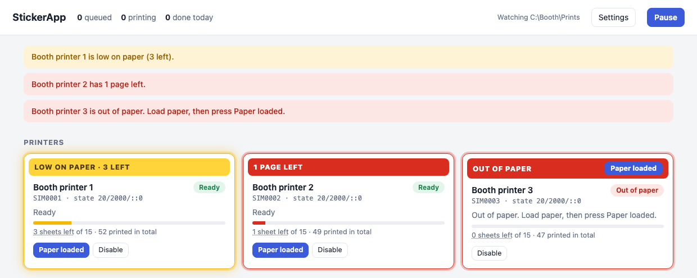
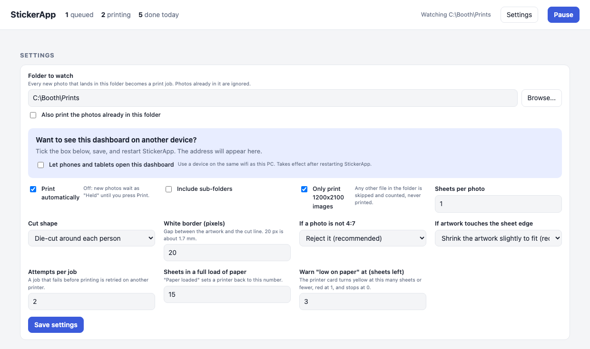

# StickerApp

Watches a folder of photo-booth pictures and prints + die-cuts each one as a sticker on
Liene PixCut S1 printers, with a local dashboard, a Reprint button, paper tracking and a
printer pool (round-robin, skipping busy or sleeping printers).

Built for photo booths running Windows with Lumabooth, but it works with anything that drops
1200 x 2100 images into a folder.

> **Not affiliated with Liene.** This is an independent project. It talks to the printer over
> USB using a protocol worked out by observing a printer you own. Use it at your own risk:
> a real print uses a sticker sheet, so try the simulator first (see the end of this page).

**Contents:** [Set up](#set-up-once) · [Start it](#start-it-with-a-real-printer) ·
[Dashboard tour](#the-dashboard) · [Paper tracking](#paper-tracking) · [Settings](#settings) ·
[Problems](#when-something-looks-wrong) · [Try it without a printer](#try-it-without-a-printer)

---

## Set up (once)

You need a Windows PC, Python 3, the S1 connected by USB, and Lumabooth set up to make sticker sheets.

### Part 1: Install StickerApp

1. Open the repo folder in PowerShell and run:

        py -m venv .venv
        .venv\Scripts\python.exe -m pip install -r requirements.txt

2. **Close the Liene Photo app** if you have it. It claims the same USB connection as StickerApp,
   so only one of them can run at a time.

### Part 2: Set up Lumabooth

StickerApp prints whatever picture Lumabooth saves into the event's **Prints** folder, so Lumabooth
has to produce pictures that are the right size and shape for a sticker sheet.

**1. Create an AI prompt for the stickers.** In Lumabooth, create an AI prompt that turns each guest's
photo into a sticker-style picture. Write it so the result is a character on a plain white
background with a wide empty margin, because the printer cuts around the artwork. Here is an
example for Halloween stickers. Copy it and change the details to suit your event:

> Turn the person in this photo into a fun, cute cartoon-style Halloween sticker character. Keep their
> face, hair, glasses and expression clearly recognizable. Give them a Halloween costume, such as a
> witch hat, a vampire cape or a skeleton outfit, and add a few small spooky details like bats,
> pumpkins and spiderwebs close to them. Use bold, bright colors and clean outlines, like a die-cut
> sticker. Use a plain solid white background with no shadows, gradients or scenery. Show them from
> the waist up, centered in a tall portrait picture. Leave a wide empty white margin of about half
> an inch on every side: no part of the picture, including hats, hands and decorations, may come
> near the edges.

**2. Set the print size.** The sticker paper is 4 x 7 inches, so in Lumabooth set the print to a
**custom paper size of 4" wide by 7" tall** (portrait). The finished image is then 1200 x 2100
pixels, which is what StickerApp expects.

**3. Keep the artwork out of the 0.5" margin.** Nothing in the picture may go inside **0.5 inch from
every edge** (top, bottom, left and right). The printer cuts a line just outside the artwork,
and anything too close to the edge can be clipped or cut badly. The prompt above asks for this
margin. If you design your own layouts or overlays, keep them inside it as well. (If a picture
does come out too close to an edge, StickerApp shrinks it slightly to fit by default, but it is
better to get it right in Lumabooth.)

**4. Find the Prints folder StickerApp should watch.** StickerApp needs to know which folder
Lumabooth saves the finished pictures into:

1. In Lumabooth, open your event on the machine and go to **General**.
2. Find the event's file location (the folder where the event's files are saved) and **copy that location**.
3. Open Windows File Explorer, paste the location into the address bar, and press Enter.
4. Inside that folder, open the folder named **Prints**. This is where the finished pictures appear.
5. Click the address bar at the top of File Explorer so the full path turns into text, and copy it
   (Ctrl+C). It will look something like `C:\...\Your Event\Prints`.
6. You will paste this path into StickerApp's **Settings > Folder to watch** when you first
   start it (see the next section).

Each new event usually has its own folder, so repeat these steps and update **Folder to watch**
whenever you start a new event.

## Start it with a real printer

1. Plug the S1 into the PC with its USB cable and **press its power button**. The S1 goes to
   sleep after a while and disappears from the PC, so you may need to press the button again later.
2. In the repo folder, **double-click one of these files:**

   | File | What happens |
   |---|---|
   | `run_stickerapp.bat` | Opens a black window with the app's log and **opens the dashboard in your browser**. Closing the window stops the app. Best while you are setting up. |
   | `run_stickerapp_hidden.vbs` | Runs with no window. Open `http://localhost:8080/` yourself. To start it at every login, press **Win+R**, type `shell:startup`, press Enter, and put a shortcut to this file in the folder that opens. |

3. **What you should see.** In the black window, after a few seconds:

        StickerApp running at http://localhost:8080/
        Printer found: <the printer's serial number>
        Printer <serial> connected

   In the browser, a printer card appears under **Printers**. It says **Warming up** for a few
   seconds, then **Ready** in green. If you see "No printers yet", see
   [When something looks wrong](#when-something-looks-wrong).
4. **Choose the folder to watch.** Click **Settings**, paste the **Prints** folder path you copied
   in [Part 2](#part-2-set-up-lumabooth) into **Folder to watch** (or press **Browse** and pick it),
   and press **Save settings**. Photos already in the folder are ignored; only new ones print.
5. **Test it.** Drop one 1200 x 2100 photo into the folder. Within a few seconds it appears under
   **Queue and history**, goes to **Printing**, and the printer prints and cuts it. A sheet takes
   about 2 minutes 15 seconds. When it says **done**, check the sticker.

To stop the app, close the black window (or press Ctrl+C in it). If you used the hidden launcher,
end `pythonw.exe` in Task Manager.

## How a photo becomes a sticker

1. A new .jpg/.jpeg/.png appears in the watched folder and stops changing for 2 seconds.
2. By default only images that are **exactly 1200 x 2100** are printed. Anything else is skipped
   and counted at the top of the dashboard. (You can change this in Settings.)
3. A die-cut path is drawn 20 px outside each person (or a plain rectangle, in Settings).
   Every photo on the sheet becomes its own sticker.
4. The job goes to the next free printer in rotation (printer 1, 2, 3, back to 1). Busy,
   sleeping or errored printers are skipped.
5. The dashboard shows progress until the printer reports the sheet finished.

## The dashboard

Open `http://localhost:8080/` on the PC (or on a phone, see [Settings](#settings)). It refreshes by itself.

### Top bar

- **Counts:** how many jobs are queued, printing, held, done today and failed today.
- **Watching ...:** the folder being watched.
- **Settings:** opens or closes the settings panel.
- **Pause:** stops sending jobs to the printers. New photos still queue up. The button changes to
  **Resume printing**.
- **Banners** under the bar explain problems in plain words, such as a printer needing attention,
  low paper, or no printer found.

### Printers

One card per printer, shown in a fixed order.

| Part of the card | What it tells you |
|---|---|
| Name | Click it to rename the printer (for example "Booth 1"). |
| Status pill | **Ready**, **Busy**, **Starting**, **Not found**, **Needs attention**, **Out of paper** or **Disabled** (see the table below). |
| Serial number | How StickerApp tells printers apart. The numbers after it are the printer's raw state code. |
| Progress bar and text | What the printer is doing right now, such as "Sending to printer", "Printing" or "Cutting". |
| "N sheets left" | The paper count (see [Paper tracking](#paper-tracking)). Click it to type in a number. |
| **Paper loaded** | Press it after you refill the tray. |
| **Disable / Enable** | Take a printer out of the rotation without unplugging it. |
| **Resume** | Appears after a failure. Check the printer first, then press it. |

| Status | Meaning |
|---|---|
| Ready | Idle, will take the next job. |
| Busy | Printing. |
| Starting | Just woke up (a few seconds). |
| Not found | Asleep or unplugged. Press its power button. Jobs wait in the queue. |
| Needs attention | A job failed, or the printer reported a problem such as paper pulled out. Check paper, ink and for jams, then press **Resume**. |
| Out of paper | The count reached 0. No jobs are sent here until you press **Paper loaded**. |
| Disabled | You turned it off. |

### Queue and history

Every photo becomes a row with a preview showing the cut line (click the preview to see it larger).

| Status | Meaning | Buttons |
|---|---|---|
| queued | Waiting for a free printer. | Cancel |
| held | Waiting for you (only when auto-print is off). | Print, Cancel |
| printing | On a printer right now. | none |
| done | Printed and cut. | **Reprint** |
| failed | Something went wrong; the reason is shown under the name. | Retry, Reprint |
| cancelled | You cancelled it. | Retry |

- **Reprint** makes a new copy of the same sheet, so a guest can have a second sticker. It prefers a
  different printer than the one that made the original, if another is online.
- **Retry** sends the same job again. Before pressing it on a failed job, check whether the sheet
  already printed. The S1 can finish a sheet after the app has given up on it.
- Jobs and sheets older than 30 days are removed when the app starts.

### Log

**Show recent activity** at the bottom lists what the app has done. The same log is saved in
`app\data\stickerapp.log`. Include it when asking for help.

## Paper tracking

The printer cannot tell the app how much paper is in it, so the app counts for you. Each card shows the
sheets left (a full load is 18 by default, changeable in Settings). Every finished sheet takes one off.

| Sheets left | What the card does |
|---|---|
| more than the "low" number (3 by default) | Normal. |
| 3 or 2 | Yellow glow and a yellow **Low on paper** strip. |
| 1 | Red flashing glow and a **1 page left** strip. |
| 0 | Red **Out of paper** strip with a **Paper loaded** button. No jobs are sent to that printer. Other printers keep working. |

After refilling, press **Paper loaded** to set the count back to a full load. If you loaded a
different number, click the "N sheets left" text and type the real number.
The count is only as good as those two buttons: a jam or failed print that wasted a sheet is not
counted, so correct it by typing the number.

## Settings

Click **Settings** in the top bar.

| Setting | What it does |
|---|---|
| Folder to watch | Where the booth software saves photos. **Browse** only works on the PC itself. Tick "Also print the photos already in this folder" if you want existing files printed. |
| Let phones and tablets open this dashboard | Lets other devices on the same wifi open the dashboard, using the address shown at the top of the box. Takes effect after you restart the app. There is **no login**, so use it only on a network you trust. Windows may need a firewall rule for port 8080 on private networks. |
| Print automatically | Off: new photos wait as **held** until you press **Print**. |
| Include sub-folders | Also watch folders inside the chosen one. |
| Only print 1200x2100 images | Skips any other size and counts it, so stray files never use up paper. |
| Sheets per photo | How many copies of each photo to print. |
| Cut shape | Die-cut around each person, or a rectangle around each photo. |
| White border (pixels) | Gap between the artwork and the cut line. 20 px is about 1.7 mm. |
| If a photo is not 4:7 | Reject it (recommended), or scale to fit. |
| If artwork touches the sheet edge | Shrink it slightly to fit (recommended), pull the cut line inward, or fail the job. |
| Attempts per job | A job that fails before printing is retried on another printer. |
| Sheets in a full load of paper | What **Paper loaded** resets the count to. |
| Warn "low on paper" at | When the card turns yellow. Red is always at 1, and 0 stops the printer. |

## When something looks wrong

| You see | Try this |
|---|---|
| "No printers yet" or **Not found** | Press the printer's power button and wait a few seconds. Check the USB cable. Make sure Liene Photo is closed. |
| **Needs attention** after a failed job | Look at the printer (light, paper, ink, jam), fix it, then press **Resume**. |
| "Paper problem" while printing | Reload or straighten the paper. The S1 keeps the sheet and carries on by itself once it is fixed. |
| Dashboard says "Lost contact" | The app stopped. Start it again. Do not delete `app\data` while it runs. |
| Nothing prints when you drop a photo | Is it exactly 1200 x 2100 (or turn off the exact-size setting)? Is the folder the one in **Settings**? Is **Pause** on? |
| "Port 8080 is already in use" | StickerApp is probably already running. Open `http://localhost:8080/`. |

More detail on the files the app keeps is in [app/README.md](app/README.md).

## Try it without a printer

The simulator pretends to be one or more S1 printers, so you can click around without using paper.
Each fake sticker takes 25 seconds (use `--sim-seconds 5` to speed it up).

Windows:

    run_stickerapp.bat --simulate 2

Mac or Linux:

    python3 -m venv .venv
    .venv/bin/python -m pip install pillow numpy opencv-python-headless
    .venv/bin/python app/main.py --simulate 2 --sim-seconds 5 --open

The simulated cards have extra **Sleep (sim)** and **Fail next job (sim)** buttons for testing.
Add `--data some_folder` to keep the test settings and history away from your real ones.

## Feedback

Issues and pull requests are welcome.

## License

MIT, see [LICENSE](LICENSE).
